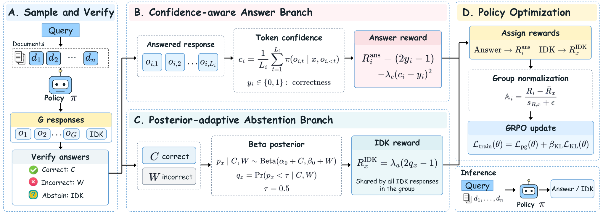

<h1 align="center"> CalibraRL: Confidence-Calibrated Reinforcement Learning for Mitigating Hallucinations in RAG</h1>


# Architecture



This is the repository for the paper: **CalibraRL: Confidence-Calibrated Reinforcement Learning for Mitigating Hallucinations in RAG**. Our method comprises three key components:

- Confidence-Aware Answer Reward

- Posterior-Adaptive Abstention Reward

- Confidence-Calibrated Policy Optimization

# Updates

🚀 2026.10: Initial release of codes

Our code, datasets, and models will be made publicly available upon acceptance.


# Contents
1. [Installation](#installation)
2. [Datasets](#datasets)
3. [Training](#training)
4. [Inference](#inference)


# Installation

```shell
conda create -n CalibraRL python=3.10
conda activate CalibraRL
pip install -r requirements.txt
```


# Datasets


Due to storage limitations and double-blind review requirements, the three QA datasets are available from public sources. Retrieved documents can be obtained using [Self-RAG](https://github.com/AkariAsai/self-rag#:~:text=at%20Inference.-,Retriever%20Setup,-By%20default%2C%20we). 


# Training

This section describes how to fine-tune CalibraRL using Group Relative Policy Optimization (GRPO) with LoRA, including hyperparameters and example training commands.

## Training Environment

- Four NVIDIA RTX PRO 6000 GPUs
- LLaMA-3-8B-Instruct and Qwen2.5-7B-Instruct as backbone models
- HuggingFace Transformers and TRL libraries
- LoRA (Low-Rank Adaptation) for parameter-efficient fine-tuning

## Example Hyperparameters

| Hyperparameter | Description | Value |
|----------------|-------------|-------|
| Batch Size | Training batch size | 4 |
| Gradient Accumulation | Number of gradient accumulation steps | 8 |
| Learning Rate | Initial learning rate | 1e-6 |
| Warmup Ratio | Learning rate warmup ratio | 0.03 |
| LoRA Rank / Alpha / Dropout | LoRA configuration | 64 / 128 / 0 |
| Number of Epochs | Training epochs | 1 |
| Samples per Query | Responses sampled per query | 32 |
| Sampling Temperature | LLaMA3 / Qwen2.5 | 1.0 / 1.2 |
| GRPO Clipping Parameter | Policy ratio clipping parameter | 0.2 |
| KL Coefficient | KL regularization coefficient | 0.01 |
| Confidence Penalty Weight | Weight of the confidence penalty | 0.5 |
| Abstention Reward Scale (λₐ) | Scaling factor for the abstention reward | 0.5 |


## Example Training Command

```bash
bash CalibraRL/bash/tain_calibrarl.sh
```


# Inference 

We evaluate reliability and confidence calibration using Precision (Prec.), Truthfulness (Truth.), Effective Reliability (ER), and Expected Calibration Error (ECE). Prec. measures accuracy among non-abstained responses; Truth. measures the proportion of correct answers or abstentions; ER measures the correct-answer ratio minus the incorrect-answer ratio; and ECE measures confidence calibration on non-abstained responses. Higher Prec., Truth., and ER and lower ECE indicate better performance.

```shell
bash  CalibraRL/bash/inference.sh
```

